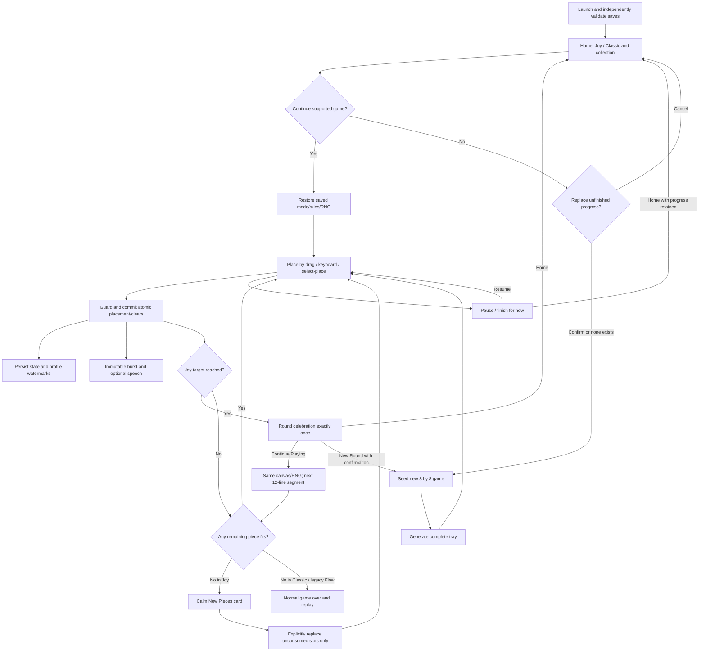
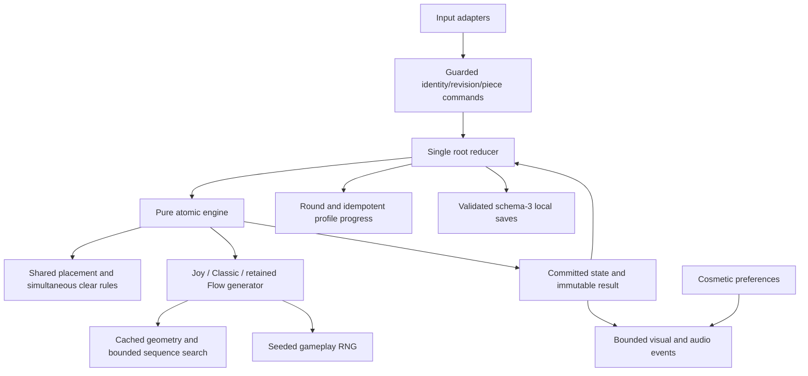
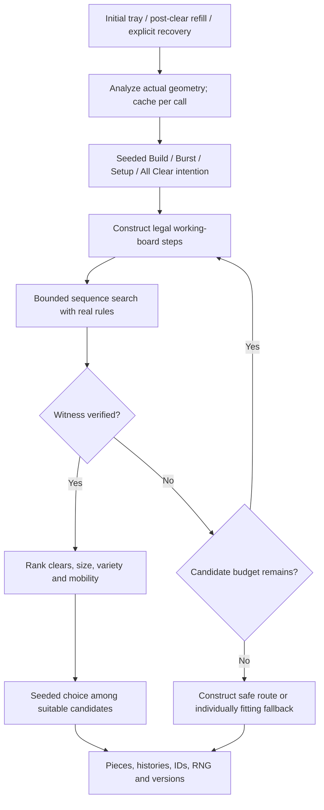
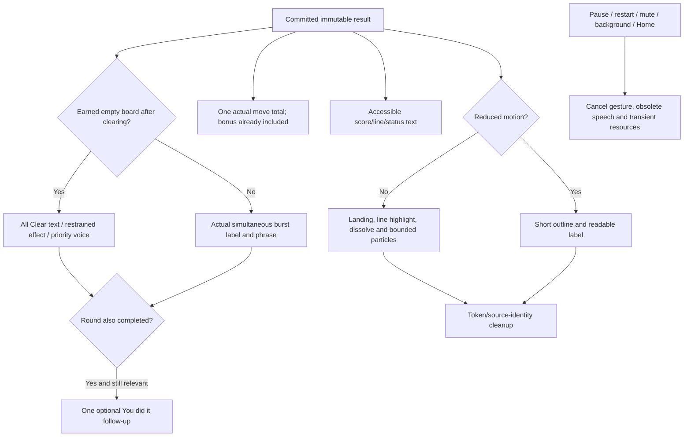

# Connected Joy workflows

## Application

Refill occurs after clears and final-slot consumption, before goal/move status. A win takes precedence over recovery. Continue recomputes legal moves and offers recovery if still needed. A single burst never awards several segments.

## Dependency structure

Audio, animation and theme callbacks do not dispatch gameplay outcomes. Persistence observes committed profile/game references, not drag state, and does not wait for animation.

## Joy generation

A constructed route is itself proof even if a separate generic search exhausts its budget. Unknown is not impossible. A large piece may be blocked initially and fit later after a witnessed clear; Make room first communicates this without revealing a solution. No visible piece is secretly replaced.

## Feedback and voice

Main effects last about 480 ms (200 ms reduced); they never lock the next legal active-game move. New moves retire older overlays so old colours cannot hide new tiles. Speech has one active source and at most one relevant round-win follow-up; no general queue or saved events.

## Input, appearance and continuity

The preserved drag hook coalesces pointer events to one pending RAF, uses transforms, measures at pickup/release/invalidation and commits release coordinates. Geometry derives from the shared eight-cell size including scaled gaps. Keyboard/select-place use the same validator/command. Pause, navigation, visibility and geometry invalidation cancel gestures. Board line previews call the same pure simulation on one candidate, not catalogue generation.

Theme gallery changes CSS tokens only, including portal dialogs and drag overlays. New look each game uses cosmetic entropy at a new-game boundary, never gameplay RNG. Existing themes remain selectable under Previous looks. Backgrounding flushes committed saves, cancels input/speech and pauses active sessions. Focus-managed dialogs trap/restore focus and short screens remain scrollable.
